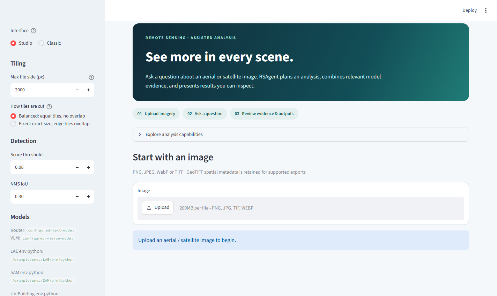
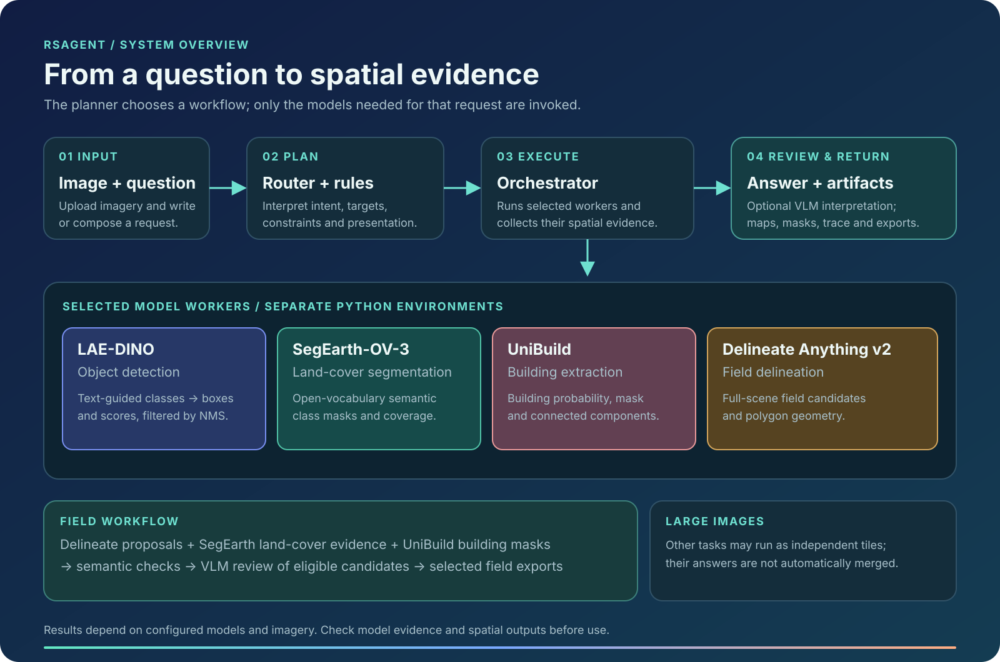
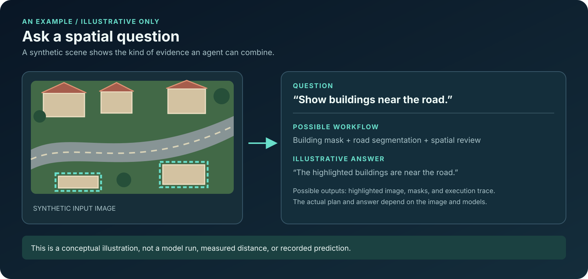

# 🛰️ RSAgent

**Ask a question about an aerial or satellite image and explore the evidence behind the answer.** RSAgent combines a language-model planner, remote-sensing models, and an optional vision-language review in a Streamlit research interface. The planner selects tools for each request; the interface displays the result, evidence and execution trace.



*Studio’s starting screen; example paths are shown. Choose Classic in the sidebar to switch layouts.*



## 🔎 What happens when you ask?

1. **Upload and ask.** Provide an image and a natural-language question, or use the task composer to draft one.
2. **Plan.** A text model translates the question into a structured intent. Rules validate the subject, class scope and requested presentation.
3. **Collect evidence.** The orchestrator starts only the selected model workers, each in its own Python environment. Workers return detections, semantic masks, building components or field candidates.
4. **Decide and present.** A vision-language model (VLM) can interpret the image and evidence; a plain map can bypass it. The UI shows the answer, visual results, trace and available downloads.

| Worker | Purpose | Example request |
| --- | --- | --- |
| LAE-DINO | Detect discrete objects | “Locate ships.” |
| SegEarth-OV-3 / SAM 3 | Segment land-cover classes | “Map water and roads.” |
| UniBuild | Extract building pixels and components | “Show buildings as a mask.” |
| Delineate Anything v2 | Propose individual agricultural fields | “Delineate fields near buildings.” |

Field requests use **full-scene** Delineate tiling and merging, together with SegEarth semantic evidence, building protection and VLM review. Other large images can be split into independent tiles; their answers are **not automatically merged**. The actual plan depends on the question and the router response.

## 💡 Examples



*The illustration is schematic, not a model prediction.* Actual answers and counts depend on the image, model settings and selected evidence.

| Question | Typical processing | What you can inspect |
| --- | --- | --- |
| “Show buildings as a mask.” | UniBuild → building components → optional VLM selection | Building mask, components and trace. |
| “Map water and roads.” | SegEarth → class map; a plain map can skip VLM review | Color map, class IDs and pixel coverage. |
| “Delineate agricultural fields near buildings.” | UniBuild + SegEarth + Delineate → semantic checks → VLM review | Field proposals, selected polygons, masks and trace. |

A local UniBuild smoke test on one existing image produced 235 connected components and 34.66% building pixels, matching that image’s saved reference mask. Its VLM was **stubbed**, and this is a software check, not an accuracy claim or a result to expect on another image.

## 🧰 Requirements at a glance

This repository contains the **agent**, not the external model repositories, checkpoints, imagery or credentials. Install only the model workers needed for your questions; field delineation needs SegEarth, UniBuild and Delineate. A model may also be needed for a follow-up mask or combined request.

| Component | Environment and files | Needed for |
| --- | --- | --- |
| Agent UI | Modern Python, `requirements_agent.txt`, text and image-capable OpenAI-compatible endpoint | Streamlit and planning/review |
| LAE-DINO | Separate upstream Python 3.8 / MMDetection environment, LAE checkpoint and local BERT files | Object detection |
| SegEarth | Modern PyTorch/SAM 3 environment, `requirements_segearth.txt`, SAM 3 checkpoint | Land-cover maps and field evidence |
| UniBuild | Separate environment, `requirements_unibuilding.txt`, UniBuild source and checkpoint | Buildings and field evidence |
| Delineate | Separate Python 3.11/3.12 environment with GDAL and `requirements_delineate.txt`, source and checkpoint | Field polygons |

Use Git and Conda/Miniconda on Windows or Linux/WSL 2. Disk, RAM and inference time depend on the models and images; a compatible GPU can help. The older LAE stack and modern workers have conflicting dependencies, so **one pip install is not enough**. Pick PyTorch builds for your OS and CUDA version before installing model requirements. Model terms, gated weights and upstream installation instructions apply.

> **WSL:** use Linux Python interpreters, Linux Conda environments and Linux paths when launching from WSL. Windows `.exe` interpreters and virtual environments cannot be used by Linux Python. If Windows and WSL share a checkout, they share its `.env`; separate checkouts avoid switching paths.

## 🚀 Installation

The commands below show a Linux/WSL setup. Use a Conda-enabled terminal and replace paths, environment names and model IDs with your own. On Windows, use Conda PowerShell/Prompt, Windows interpreter paths, and `Copy-Item .env.example .env` instead of `cp`. A clean installation depends on the upstream projects and is not yet validated on every platform.

### 1. Get RSAgent and the model sources

```bash
git clone https://github.com/opsai2025/RSAgent.git
cd RSAgent
cp .env.example .env
# Keep this directory open: the commands below assume you are inside RSAgent.
mkdir -p ~/rsagent-models ~/rsagent-models/weights
git clone https://github.com/jaychempan/LAE-DINO.git ~/rsagent-models/LAE-DINO
git clone https://github.com/earth-insights/SegEarth-OV-3.git ~/rsagent-models/SegEarth-OV-3
git clone https://github.com/zhu-xlab/UniBuild.git ~/rsagent-models/UniBuild
git clone https://github.com/Lavreniuk/Delineate-Anything.git ~/rsagent-models/Delineate-Anything
```

You can clone only the projects you need. Obtain weights separately from the official sources:

| Project | Source and checkpoint | Additional notes |
| --- | --- | --- |
| LAE-DINO | [Source](https://github.com/jaychempan/LAE-DINO) · [LAE-1M weights](https://huggingface.co/ML4Sustain/LAE-DINO) | Download the Swin-T LAE-1M checkpoint and [bert-base-uncased](https://huggingface.co/google-bert/bert-base-uncased) files. |
| SegEarth | [Source](https://github.com/earth-insights/SegEarth-OV-3) · [SAM 3](https://huggingface.co/facebook/sam3) | SAM 3 access may require accepting terms and a Hugging Face token. |
| UniBuild | [Source](https://github.com/zhu-xlab/UniBuild) · [weights](https://drive.google.com/drive/folders/1YZ-bbXoZ1rOKQayRL79bLdhIE_CcU3K9) | This adapter expects `unibuild_dinov3_base_hrdpt.pth`. |
| Delineate | [Source](https://github.com/Lavreniuk/Delineate-Anything) · [v2 weights](https://huggingface.co/MykolaL/DelineateAnything/resolve/main/DelineateAnythingv2.pt) | This upstream project uses AGPL-3.0. |

### 2. Create the environments

Create a separate environment for each selected model. Inside it, follow the upstream installation instructions and choose a compatible PyTorch build, then install RSAgent’s integration requirements:

```bash
# Agent UI, and optionally SegEarth in the same modern environment:
conda create -n SAM python=3.11
conda activate SAM
# Install the PyTorch build and SegEarth/SAM 3 dependencies for your system first.
python -m pip install -r requirements_agent.txt
python -m pip install -r requirements_segearth.txt

# UniBuild worker, after installing a compatible PyTorch build:
conda create -n geopython python=3.10
conda activate geopython
python -m pip install -r requirements_unibuilding.txt

# Delineate worker: install GDAL through conda-forge first:
conda create -n rsagent-delineate -c conda-forge python=3.12 gdal
conda activate rsagent-delineate
python -m pip install -r requirements_delineate.txt
```

For LAE-DINO, create its **separate** environment using the upstream Python 3.8/MMDetection instructions. Install model-specific dependencies there; it does not use `requirements_agent.txt`. Choose fresh environment names if these names already exist. GDAL’s native library and Python bindings must match. These requirement files are integration starting points, not a complete cross-platform lockfile. Check that SegEarth contains `sam3/`, UniBuild contains `infer_geotiff.py`, and Delineate contains `methods/main/inference.py` and `conf_sample.yaml`.

### 3. Configure `.env`

Edit the copied `.env`; use **absolute paths belonging to the OS running Streamlit**. Replace the sample values below with real locations. The interpreter paths are the Python executables *inside* the appropriate environments.

```dotenv
OPENAI_API_KEY=your-key
OPENAI_BASE_URL=
ROUTER_MODEL=your-text-model
VLM_MODEL=your-image-capable-model
LAE_DINO_ROOT=/home/user/rsagent-models/LAE-DINO
LAE_CHECKPOINT=/home/user/rsagent-models/weights/lae_dino_swint_lae1m-28ca3a15.pth
LAE_BERT_DIR=/home/user/rsagent-models/LAE-DINO/weights/bert-base-uncased
SEGEARTH_ROOT=/home/user/rsagent-models/SegEarth-OV-3
SAM3_CHECKPOINT=/home/user/rsagent-models/weights/sam3.pt
UNIBUILD_REPO=/home/user/rsagent-models/UniBuild
UNIBUILD_CHECKPOINT=/home/user/rsagent-models/weights/unibuild_dinov3_base_hrdpt.pth
DELINEATE_UPSTREAM=/home/user/rsagent-models/Delineate-Anything
DELINEATE_CHECKPOINT=/home/user/rsagent-models/weights/DelineateAnythingv2.pt
LAE_PYTHON=/home/user/miniconda3/envs/LAE/bin/python
SAM_PYTHON=/home/user/miniconda3/envs/SAM/bin/python
UNIBUILD_PYTHON=/home/user/miniconda3/envs/geopython/bin/python
DELINEATE_PYTHON=/home/user/miniconda3/envs/rsagent-delineate/bin/python
```

Leave `OPENAI_BASE_URL` blank to use the SDK default; the endpoint must support the configured text and image models. Set `HF_TOKEN` if needed for SAM 3 access. `LAE_CONFIG_FILE`, `RGB_BANDS`, device settings and other overrides are documented in `.env.example` and `config.py`. Paths default to the original sibling-directory layout if left blank. Do not commit `.env` or credentials.

### 4. Launch and check

```bash
conda activate SAM
python -m streamlit run app.py
```

Open the URL printed in the terminal. Upload an image, select a task or write a question, then run the analysis. Studio is the redesigned interface; the sidebar also offers Classic, and the preserved original can be launched with `python -m streamlit run app_legacy.py`.

For offline checks in the agent environment:

```bash
python -X utf8 selftest.py
python -m unittest -v test_fields test_ui_composer
```

The `smoketest_*.py` scripts need configured models and imagery. `smoketest_unibuilding.py --image /path/to/image.png` runs the real UniBuild worker with a stubbed VLM; `smoketest_fields.py` defaults to controlled semantics and a stubbed VLM. The LAE smoke script expects the local `Google_Earth/Capture06.PNG` sample. See the scripts before running them.

## 🗺️ Outputs and scientific use

PNG, JPEG, WebP and TIFF inputs are supported. Compatible GeoTIFF exports preserve source CRS and transform; non-georeferenced images use pixel coordinates. `RGB_BANDS` selects TIFF bands and non-byte input is stretched for display. Runs and worker logs are stored locally under `runs/` and `logs/`. Depending on the task, downloads can include maps, masks, class IDs, field GeoPackages, proposal JSON and traces. Field proposal JSON is pixel geometry, not RFC 7946 GeoJSON.

Model predictions and VLM judgments are **not ground truth**. Semantic fractions used in field filtering are heuristics, not calibrated confidence scores. Inspect the trace and verify outputs against independent reference data. Record model/source versions, checkpoint hashes, settings, input metadata and endpoint model for reproducibility. Upstream source revisions are not all pinned; the locally inspected UniBuild and Delineate revisions were `eeb56ff95514ef61e4c4e4098d55e3a69c764f9e` and `653e261c856356b9614cd15e964cf437bf8b846e`, respectively. A VLM request can send imagery and context to the configured endpoint.

## 🛠️ Troubleshooting

- **Worker not found or model fails to load:** check the corresponding interpreter, repository and checkpoint paths in `.env`; inspect the run trace and `logs/`.
- **Endpoint error:** verify the key, base URL and model IDs; the VLM needs image input support. Restart Streamlit after changing configuration.
- **Missing field output:** check SegEarth, UniBuild and Delineate evidence and the trace. A failed required step is not a verified empty prediction.
- **Large image:** review tiling in the sidebar. Ordinary tile results are independent; field requests use Delineate’s native full-scene workflow.

The main implementation is in `planner.py`, `orchestrator.py`, `vlm.py`, `tools/` and `workers/`; the interface is in `app.py`. Cite the original [LAE-DINO](https://github.com/jaychempan/LAE-DINO), [SegEarth](https://github.com/earth-insights/SegEarth-OV-3), [SAM 3](https://huggingface.co/facebook/sam3), [UniBuild](https://github.com/zhu-xlab/UniBuild) and [Delineate Anything v2](https://arxiv.org/abs/2607.19069) works according to their respective documentation and licenses.
